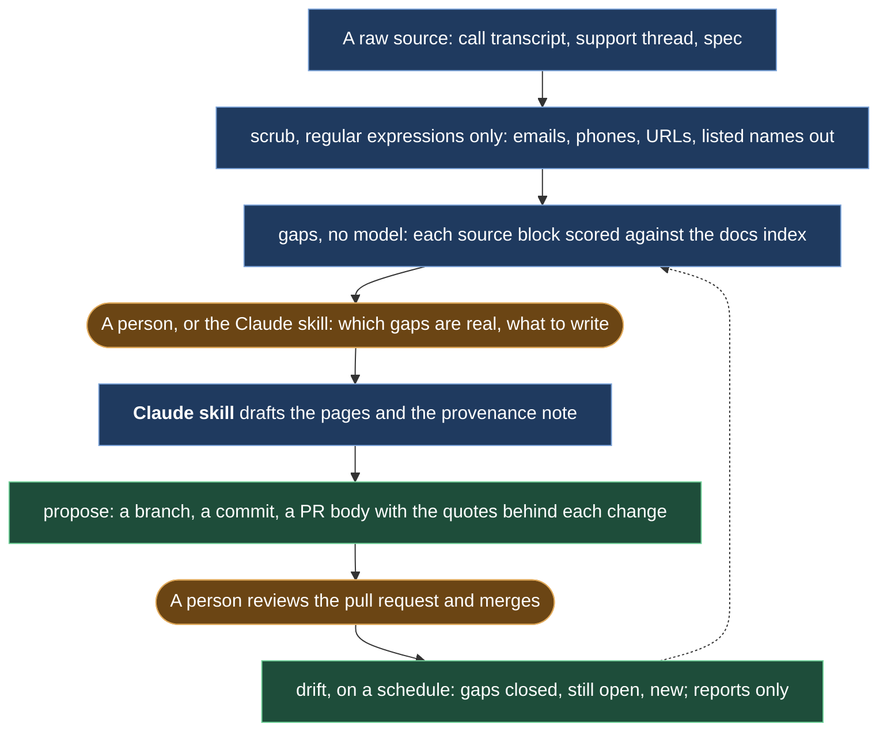

# source-to-docs

Turns a call transcript, a support thread or a spec into documentation changes you review in a pull request, then watches the docs for drift. A full session with its output: [`examples/northwind/WALKTHROUGH.md`](examples/northwind/WALKTHROUGH.md).

## Preview

```text
$ source-to-docs scrub sources/support-thread.md --out clean --names names.txt
wrote clean/support-thread.md (email: 3, phone: 1, url: 1, person: 8)

$ source-to-docs gaps clean/support-thread.md docs --out reports/gaps-support-thread.md
4 blocks, 4 candidate gaps, report in reports/gaps-support-thread.md
  gap: block 1, Getting all photos out of a project at ... (0.267)
  gap: block 2, Hello [person-1], yes. In the web app go ... (0.333)
  gap: block 3, That worked, thanks. One more thing: the link ... (0.2)
  gap: block 4, Clear, thank you. Also, our field team asked ... (0.267)

$ source-to-docs propose docs --branch docs/photo-bundle --title "docs: photo bundle export" --provenance clean/support-thread.md
committed 3 file(s) on branch docs/photo-bundle; dry run, no pull request opened

# docs: photo bundle export

## Summary

- `docs/exports/csv-and-geojson.md`: modified, +1 -1
- `docs/exports/photo-bundle.md`: added, +21 -0
- `docs/sync/offline-sync.md`: modified, +2 -0

## Provenance

- Original: `sources/support-thread.md`
- Scrubbed at: 2026-10-16T10:43:17+00:00
...
```

## What it does



1. `scrub`: replaces emails, phone numbers, URLs with tokens and listed names with placeholders before any model reads the file.
2. `index`: lists every markdown page, its headings and the keywords under each heading.
3. `gaps`: splits a clean source into blocks, matches each block against the index and lists the blocks the docs do not cover.
4. `propose`: creates a branch, commits the changed pages and prints a pull request body with provenance and a reviewer checklist. Dry run by default, never merges, refuses `main`.
5. `drift`: re-runs the matching for every clean source and reports gaps closed, still open and new since the last run.

The judgment between steps 3 and 4, which gaps are real and what to write, is done by a person or by the Claude Code skill in `skill/`.

**Constraints:** scrub runs before any model reads a file. Propose is a dry run by default, never merges, and refuses `main`. Drift only reports.

## Why this exists

We rebuilt three public documentation sites this way, from help files, support threads and demo transcripts, every change in a pull request and a weekly drift watch on top. This is the pattern, rebuilt fresh in October 2026 on an invented product; the originals stayed where they were built. The story is [Docs as code, three sites](https://github.com/nunomnferreirapt/ai-operated-growth-engine/blob/main/evidence/case-studies/04-docs-as-code-three-sites.md) and the mechanism is [Drift watch](https://github.com/nunomnferreirapt/ai-operated-growth-engine/blob/main/architecture/patterns/drift-watch.md), both in the showcase it came from.

## Requirements

- Python 3.12 or later
- git
- `gh`, only for `propose --open-pr`
- `uv`, or plain `pip`

## Install

```bash
git clone https://github.com/nunomnferreirapt/source-to-docs.git
cd source-to-docs
uv sync
uv run source-to-docs --help
```

For the command on your path: `uv tool install .` or `pip install .`. Tests: `uv run pytest`.

## Usage

CLI, in a docs repo:

```bash
source-to-docs scrub raw/call.txt --out clean --names names.txt
source-to-docs gaps clean/call.md docs --out clean/gaps-call.md
# write the doc changes and docs/.source-to-docs/provenance.md
source-to-docs propose docs --branch docs/call --title "docs: ..." --provenance clean/call.md
source-to-docs drift docs --sources clean
```

In Claude Code, with the skill installed (`skill/README.md`): `/source-to-docs update the docs from raw/call.txt`. The skill scrubs, runs the gap pass, decides, drafts, writes the provenance and runs `propose` as a dry run.

A full session with its output: `examples/northwind/WALKTHROUGH.md`.

## How the gap pass works without a model

Scrub runs first and alone, with regular expressions, so no model sees an email, a phone number or a name. The gap pass is deterministic: it tokenizes the clean source and the docs, drops stopwords, and scores each source block by the share of its keywords found under a docs heading. Low scores are candidate gaps; the report names the closest pages. Judgment and writing come after that, and `propose` turns the result into a branch, a commit and a pull request body with the quotes behind each change and a reviewer checklist.

The drift watch is the same matching run again against the current docs and compared with `.source-to-docs/drift.json`. A gap now above the threshold was closed; one below is still open; a block below it for the first time is new. It only reports, exit code 0, so it can run on a schedule without blocking anything.

## Repository layout

```text
source-to-docs/
  src/source_to_docs/
    cli.py        argparse entry point
    scrub.py      personal data to placeholders
    indexer.py    docs-index.json
    gaps.py       blocks, matching, gaps.md
    propose.py    branch, commit, PR body
    drift.py      drift.json and the report
    text.py       tokenization and keywords
  tests/          18 tests, temporary git repos, no network
  skill/          Claude Code skill: SKILL.md, README.md
  examples/northwind/
    docs/         nine invented pages
    sources/      a support thread and a demo transcript
    clean/        the scrubbed copies
    reports/      the gap reports
    proposed/     the page and provenance the skill would write
    WALKTHROUGH.md
  LICENSE         MIT
```

## License

MIT, see `LICENSE`.

Built by [Nuno Ferreira](https://www.linkedin.com/in/nunomnferreira).
